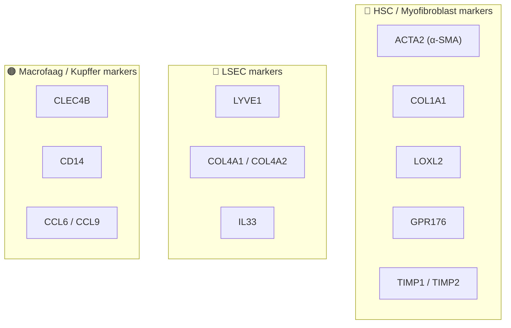

# 🧬 Uitleg Genlijst

Overzicht van de genen die je hebt opgegeven, met celtype-associatie, functie en relevantie.

---

## 🔴 HSC-Gerelateerde Genen

### 1. ACTA2 — Alpha Smooth Muscle Actin (α-SMA)
| | |
|---|---|
| **Volledige naam** | Actin Alpha 2, Smooth Muscle |
| **Celtype** | **Geactiveerde HSCs / Myofibroblasten** |
| **Functie** | Codeert voor α-SMA, het contractiele actine-eiwit dat de cytoskelet-reorganisatie van myofibroblasten aandrijft. Geeft de cel contractiele eigenschappen. |
| **Expressie** | ❌ Laag/afwezig in quiescente HSCs → ✅ **Sterk upgereguleerd** bij activatie |
| **Status** | ⭐ **DE gouden standaard activatiemarker voor HSCs** |
| **In LX-2 + TGF-β** | Basaal al aanwezig (LX-2 is pre-geactiveerd), **stijgt verder** bij TGF-β behandeling |

---

### 2. COL1A1 — Collageen Type I Alpha 1
| | |
|---|---|
| **Volledige naam** | Collagen Type I Alpha 1 Chain |
| **Celtype** | **Geactiveerde HSCs / Myofibroblasten** |
| **Functie** | Codeert voor de α1-keten van type I collageen — het **belangrijkste structurele eiwit van littekenweefsel** in de lever. Geactiveerde HSCs produceren massaal collageen I, wat leidt tot fibrose. |
| **Expressie** | ❌ Laag in quiescente HSCs → ✅ **Sterk upgereguleerd** bij activatie |
| **Status** | ⭐ **Naast ACTA2 de belangrijkste fibrose-marker** |
| **In LX-2 + TGF-β** | **Sterke toename**; TGF-β via Smad2/3 signaling induceert COL1A1 transcriptie direct |

---

### 3. LOXL2 — Lysyl Oxidase-Like 2
| | |
|---|---|
| **Volledige naam** | Lysyl Oxidase Like 2 |
| **Celtype** | **Geactiveerde HSCs** |
| **Functie** | Enzym dat collageen en elastine vezels **cross-linkt** (covalente bindingen maakt). Dit maakt de fibroselaesie rigide, onoplosbaar en resistent tegen afbraak door proteasen. Draagt bij aan onomkeerbare fibrose. |
| **Expressie** | ❌ Laag in quiescente HSCs → ✅ **Upgereguleerd** bij activatie |
| **Relevantie** | Therapeutisch doelwit — anti-LOXL2 antilichamen zijn getest in klinische trials |
| **In LX-2 + TGF-β** | **Stijgt**; indicator voor matrixstabilisatie |

---

### 4. GPR176 — G-Protein Coupled Receptor 176
| | |
|---|---|
| **Volledige naam** | G Protein-Coupled Receptor 176 (orphan receptor) |
| **Celtype** | **Geactiveerde HSCs** |
| **Functie** | Wees-receptor (ligand nog onbekend) die specifiek upgereguleerd is op geactiveerde HSCs. Speelt een **pro-fibrotische rol**: silencing/blokkering vermindert fibrogenese. |
| **Expressie** | ❌ Laag in quiescente HSCs → ✅ **Upgereguleerd** bij activatie |
| **Status** | 🆕 **Nieuw ontdekt door het LIVR lab** (De Smet et al. 2024, JHEP Reports) |
| **In LX-2 + TGF-β** | Verwacht **↑**; correleert met ernst van fibrose |

> [!TIP]
> Dit is een unieke marker uit jullie eigen lab — interessant om te valideren in je Cell Painting + qPCR setup!

---

### 5. TIMP1 — Tissue Inhibitor of Metalloproteinases 1
| | |
|---|---|
| **Volledige naam** | TIMP Metallopeptidase Inhibitor 1 |
| **Celtype** | **Geactiveerde HSCs** (ook macrofagen en hepatocyten in mindere mate) |
| **Functie** | **Remt MMP's** (matrix metalloproteinasen) die collageen afbreken. Door MMP's te blokkeren, beschermt TIMP1 het nieuw aangemaakte littekenweefsel tegen degradatie → **netto collageen accumulatie = fibrose**. |
| **Expressie** | ❌ Laag in quiescente HSCs → ✅ **Sterk upgereguleerd** bij activatie |
| **Klinisch** | Circulerend TIMP-1 is een klinische biomarker voor leverfibrose |
| **In LX-2 + TGF-β** | **Stijgt**; beschermt de geproduceerde ECM |

### 6. TIMP2 — Tissue Inhibitor of Metalloproteinases 2
| | |
|---|---|
| **Volledige naam** | TIMP Metallopeptidase Inhibitor 2 |
| **Celtype** | **HSCs**, ook breder geëxpresseerd |
| **Functie** | Vergelijkbaar met TIMP1: remt MMP's (vooral MMP-2). Regulatie van ECM-turnover. Complexere rol dan TIMP1: TIMP2 kan MMP-2 zowel remmen als activeren (via MT1-MMP complex). |
| **Expressie** | Meer constitutief geëxpresseerd dan TIMP1, maar stijgt ook bij activatie |
| **In LX-2 + TGF-β** | **Lichte stijging** verwacht |

---

## 🔵 LSEC-Gerelateerde Genen

### 7. LYVE1 — Lymphatic Vessel Endothelial Hyaluronan Receptor 1
| | |
|---|---|
| **Volledige naam** | Lymphatic Vessel Endothelial Hyaluronan Receptor 1 |
| **Celtype** | **Gezonde/gedifferentieerde LSECs** |
| **Functie** | Receptor voor hyaluronan (hyaluronzuur) op het oppervlak van sinusoïdale en lymfatische endotheelcellen. Betrokken bij hyaluronan-opname en -klaring. Markeert het gespecialiseerde, gefenestreerde LSEC-fenotype. |
| **Expressie** | ✅ **Hoog** in gezonde LSECs → ❌ **Daalt** bij capillarisatie/schade |
| **Status** | ⭐ **Standaard LSEC-identiteitsmarker** — verlies = capillarisatie |
| **Relevantie** | In Verhulst et al. (2021, LIVR) gebruikt als deel van de gezonde LSEC-signatuur |

---

### 8. COL4A1 & COL4A2 — Collageen Type IV Alpha 1 & 2
| | |
|---|---|
| **Volledige naam** | Collagen Type IV Alpha 1 / Alpha 2 Chain |
| **Celtype** | **Gecapillariseerde LSECs** + geactiveerde HSCs |
| **Functie** | Type IV collageen is het **hoofdbestanddeel van de basale membraan**. Normaal hebben gezonde LSECs **geen basale membraan** — dat is wat ze uniek maakt (open fenestrae, directe toegang tot Space of Disse). Bij capillarisatie gaan LSECs een basale membraan vormen → COL4A1/A2 expressie stijgt. |
| **Expressie** | ❌ Laag/afwezig in gezonde LSECs → ✅ **Upgereguleerd** bij capillarisatie |
| **Status** | **Capillarisatie-marker** — toename = verlies van LSEC-identiteit |

> [!IMPORTANT]
> De combinatie LYVE1 ↓ + COL4A1/A2 ↑ is een krachtige indicator dat LSECs capillariseren.

---

### 9. IL33 — Interleukine-33
| | |
|---|---|
| **Volledige naam** | Interleukin 33 |
| **Celtype** | **LSECs** (hoofdbron in gezonde lever) + geactiveerde HSCs |
| **Functie** | Alarmine/cytokine dat vrijkomt bij celschade. In de lever: (1) LSECs zijn de belangrijkste constitutieve bron van IL-33, (2) bij chronische schade stijgt IL-33 sterk, (3) IL-33 signaleert via de **ST2-receptor** en drijft **LSEC-disfunctie** + bevordert **HSC-activatie** paracrien. Creëert een feedforward loop: beschadigde LSECs → IL-33 → HSC-activatie → meer fibrose → meer LSEC-schade. |
| **Expressie** | Aanwezig in gezonde LSECs → **Sterk ↑** bij leverletsel |
| **Relevantie** | Cruciaal **crosstalk-molecuul** tussen LSECs en HSCs |

---

## 🟠 Macrofaag / Kupffer Cel Markers

### 10. CLEC4B — C-type Lectin Domain Family 4 Member B
| | |
|---|---|
| **Volledige naam** | C-type Lectin Domain Family 4 Member B (ook: DCAR, Dendritic Cell Immunoactivating Receptor) |
| **Celtype** | **Myeloïde cellen** (dendritische cellen, macrofaag-subsets) |
| **Functie** | C-type lectine patroonherkenningsreceptor. Herkent pathogeen-geassocieerde moleculaire patronen (bijv. mycobacteriële glycolipiden). Moduleert T-cel-responsen en immuniteit. |
| **Lever-context** | Niet de primaire LSEC- of Kupffercel-marker, maar gerelateerd aan het CLEC4-familie. Verwante lectines in de lever: *CLEC4G* (LSECtin, op LSECs) en *CLEC4F* (Kupffercel-marker). |

> [!NOTE]
> Let op: als dit gen in een LSEC-context verschijnt, kan het duiden op myeloïde contaminatie in je celpreparaat, of op een activatietoestand waarbij LSECs myeloïde markers oppikken.

---

### 11. CD14 — Cluster of Differentiation 14
| | |
|---|---|
| **Volledige naam** | CD14 Molecule |
| **Celtype** | **Monocyten / Macrofagen / Kupffercellen** |
| **Functie** | Co-receptor voor bacterieel lipopolysaccharide (LPS) samen met TLR4. Cruciaal voor aangeboren immuunrespons. Herkent bacteriële producten uit de darm die via de poortader de lever bereiken. |
| **Lever-context** | Hoge expressie op Kupffercellen; betrokken bij LPS-geïnduceerde inflammatie en fibrose. LPS-TLR4-CD14 signaling activeert NF-κB in Kupffercellen → cytokine-release → HSC-activatie. |
| **Relevantie** | Als CD14 opduikt in je LSEC/HSC-data: mogelijk macrofaag-contaminatie OF Kupffercel-HSC crosstalk |

---

### 12. CCL6 & CCL9 — CC-Chemokines 6 en 9
| | |
|---|---|
| **Volledige naam** | C-C Motif Chemokine Ligand 6 / 9 |
| **Celtype** | **Macrofagen, hepatocyten, LSECs** (CCL9); myeloïde cellen (CCL6) |
| **Functie** | Chemokines die **macrofagen en monocyten rekruteren** naar de lever via CCR1. CCL9 wordt ook door LSECs en hepatocyten geproduceerd en creëert chemotactische gradiënten die Kupffercellen positioneren in de sinusoïden. |
| **Bij fibrose** | **↑ Upgereguleerd** bij leverletsel → recruteert meer inflammatoire macrofagen → verergert fibrose. Hepatocyt-afgeleid CCL9 (via Myc) versterkt macrofaag-infiltratie en HSC-activatie. |

> [!WARNING]
> CCL6 en CCL9 zijn **muis-specifieke chemokines** — de humane equivalenten zijn CCL15 en CCL23. Als je met humane LX-2 cellen werkt, gebruik dan de juiste humane gennamen!

---

## 📊 Samenvatting: Alle Genen in Één Tabel

| Gen | Volledige naam | Celtype | Categorie | Bij activatie/capillarisatie |
|-----|---------------|---------|-----------|---------------------------|
| **ACTA2** | α-Smooth Muscle Actin | HSC | ⭐ Activatie | ↑↑↑ |
| **COL1A1** | Collagen Type I α1 | HSC | ⭐ Fibrose/ECM | ↑↑↑ |
| **LOXL2** | Lysyl Oxidase-Like 2 | HSC | ECM cross-linking | ↑↑ |
| **GPR176** | Orphan GPCR 176 | HSC | 🆕 Pro-fibrotisch | ↑ |
| **TIMP1** | TIMP Metallopeptidase Inhibitor 1 | HSC | ECM-bescherming | ↑↑ |
| **TIMP2** | TIMP Metallopeptidase Inhibitor 2 | HSC | ECM-turnover | ↑ |
| **LYVE1** | Lymphatic Vessel Endothelial HA Receptor 1 | LSEC | ⭐ LSEC-identiteit | ↓↓ (verlies) |
| **COL4A1** | Collagen Type IV α1 | LSEC/HSC | Basale membraan | ↑↑ (capillarisatie) |
| **COL4A2** | Collagen Type IV α2 | LSEC/HSC | Basale membraan | ↑↑ (capillarisatie) |
| **IL33** | Interleukin 33 | LSEC → HSC | Alarmine/crosstalk | ↑↑ |
| **CLEC4B** | C-type Lectin 4B (DCAR) | Myeloïd | Immuun/patroonherkenning | Context-afhankelijk |
| **CD14** | CD14 | Macrofaag/Kupffer | LPS-herkenning | ↑ bij inflammatie |
| **CCL6/CCL9** | CC-Chemokine Ligand 6/9 | Macrofaag/LSEC | Chemotaxis | ↑ bij inflammatie |

---

*Let op: CCL6 en CCL9 zijn muis-genen. De humane homologen zijn CCL15 en CCL23.*
